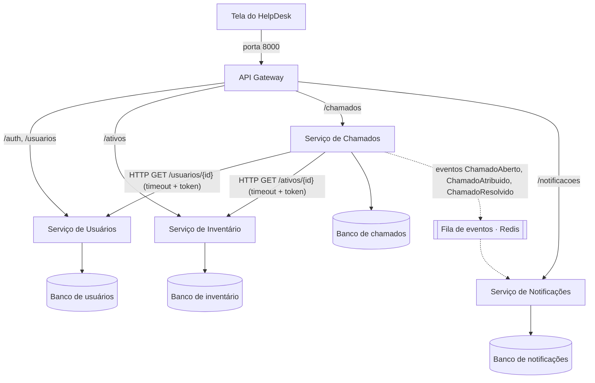

# HelpDesk TI · versão microsserviços

> 🎥 **Vídeo de demonstração:** _cole aqui o link do YouTube (não listado) ou do Google Drive_

Sistema de chamados de TI (no estilo de um GLPI simplificado), feito em **Python + FastAPI**.
Começou como um **monólito** e foi separado em **microsserviços** na atividade de
**Arquitetura de Software** (veja [DESAFIO.md](DESAFIO.md)).

## Telas do sistema


| Login | Painel do técnico | Chamado resolvido |
|---|---|---|
|  |  |  |

## Arquitetura



| Serviço | Pasta | O que faz | Banco (volume) |
|---|---|---|---|
| **API Gateway** | [gateway/](gateway) | Único ponto de entrada (porta 8000). Serve a tela e encaminha cada rota ao serviço certo. Mostra em `/saude` quais serviços estão no ar. | — |
| **Usuários** | [servicos/usuarios/](servicos/usuarios) | Login, criação do token JWT, cadastro e consulta de usuários. | `dados-usuarios` |
| **Inventário** | [servicos/inventario/](servicos/inventario) | Cadastro e consulta de equipamentos. | `dados-inventario` |
| **Chamados** | [servicos/chamados/](servicos/chamados) | Abrir, atribuir, mudar status, comentar e painel (SLA e transições). Confere técnico e equipamento por HTTP e publica eventos. | `dados-chamados` |
| **Notificações** (bônus) | [servicos/notificacoes/](servicos/notificacoes) | Consome os eventos da fila e grava os avisos de cada usuário. | `dados-notificacoes` |
| Redis (bônus) | — | Fila de eventos entre Chamados e Notificações. | `dados-fila` |

Cada serviço é um projeto próprio (com `Dockerfile`, `requirements.txt` e testes),
roda no seu contêiner e pode ser iniciado sozinho. Nenhum serviço acessa o banco de outro.

### Como os serviços conversam

- **Tela → Gateway:** a tela usa os mesmos endereços de antes (`/auth/login`, `/chamados`...). O gateway olha o primeiro trecho da rota e repassa a requisição, com o token, para o serviço certo.
- **Chamados → Usuários e Inventário (HTTP):** para abrir um chamado com equipamento, Chamados chama `GET /ativos/{id}`. Para atribuir, chama `GET /usuarios/{id}` e confere se a pessoa é técnica. As chamadas repassam o token do usuário e têm **tempo limite** (`TIMEOUT_SEGUNDOS`, padrão 3 s).
- **Chamados → Notificações (evento):** Chamados publica `ChamadoAberto`, `ChamadoAtribuido` e `ChamadoResolvido` na fila. Notificações lê a fila e grava os avisos. Se Notificações (ou a fila) cair, os chamados continuam sendo abertos, e os eventos ficam esperando na fila.

### Tratamento de falhas

| Situação | O que acontece |
|---|---|
| Inventário fora do ar | Abrir chamado **com** equipamento → `503` "O serviço de inventário está fora do ar". Listar chamados, usuários e abrir chamado **sem** equipamento continuam funcionando. |
| Usuários fora do ar | Atribuir técnico → `503`. O login também para, mas quem já entrou continua usando os outros serviços, porque cada serviço confere o token sozinho. |
| Serviço lento | Depois do tempo limite → `503` "demorou demais para responder". |
| Notificações fora do ar | Chamados funcionam normalmente; os avisos chegam quando o serviço volta. |
| Qualquer serviço fora do ar, pelo gateway | `503` com o nome do serviço. A tela continua abrindo e mostra o que estiver disponível. |

## Como rodar

```bash
docker compose up --build
```

Não precisa de nenhum ajuste manual. Depois abra **http://localhost:8000**.

- `docker compose ps` mostra todos os contêineres. Só o `gateway` tem porta publicada.
- `http://localhost:8000/saude` mostra quais serviços estão no ar.
- Para simular uma falha: `docker compose stop inventario` e depois `docker compose start inventario`.

### Contas de acesso

Todas usam a senha **`Helpdesk2026`** (mude com `SENHA_EXEMPLO` no `.env`).

| E-mail | Perfil | O que pode fazer |
|---|---|---|
| `admin@empresa.com` | Administrador | Tudo, inclusive cadastrar usuários |
| `carla@empresa.com` | Técnica | Ver todos os chamados, atribuir, resolver e cadastrar equipamentos |
| `diego@empresa.com` | Técnico | O mesmo que a Carla |
| `ana@empresa.com` | Solicitante | Abrir chamados e ver só os próprios |
| `bruno@empresa.com` | Solicitante | O mesmo que a Ana |

As contas, os equipamentos e os chamados de exemplo só são criados com `DADOS_EXEMPLO=1` (o padrão)
e com os bancos vazios. Em produção, use `DADOS_EXEMPLO=0`.

### Configuração

Copie `.env.example` para `.env` se quiser ajustar algo. O principal é o `JWT_SEGREDO`, que
assina os logins e precisa ser **o mesmo em todos os serviços** (o docker compose passa o mesmo `.env` para todos).
Se ele não for definido, o contêiner `segredo` gera um aleatório na primeira vez e guarda no volume `segredos`.

### Perfis e permissões

| Ação | Solicitante | Técnico | Administrador |
|---|:-:|:-:|:-:|
| Abrir chamado | ✅ | ✅ | ✅ |
| Ver chamados | só os seus | todos | todos |
| Comentar | nos seus | todos | todos |
| Atribuir e resolver | ❌ | ✅ | ✅ |
| Fechar ou reabrir um chamado resolvido | os seus | ✅ | ✅ |
| Cadastrar equipamentos | ❌ | ✅ | ✅ |
| Cadastrar usuários | ❌ | ❌ | ✅ |

## Rotas (todas pelo gateway, na porta 8000)

| Método | Rota | Serviço | Quem pode |
|---|---|---|---|
| POST | `/auth/login` | Usuários | Todos |
| GET | `/auth/eu` | Usuários | Logado |
| POST / GET | `/usuarios` | Usuários | Admin / logado |
| GET | `/usuarios/{id}` | Usuários | Logado (usada também por Chamados) |
| POST / GET | `/ativos` | Inventário | Técnico e admin / logado |
| GET | `/ativos/{id}` | Inventário | Logado (usada também por Chamados) |
| POST / GET | `/chamados` | Chamados | Logado (solicitante vê só os seus) |
| GET | `/chamados/painel` | Chamados | Logado |
| PATCH | `/chamados/{id}/atribuir` | Chamados | Técnico e admin |
| PATCH | `/chamados/{id}/status` | Chamados | Técnico e admin (solicitante: fechar ou reabrir) |
| POST | `/chamados/{id}/comentarios` | Chamados | Envolvidos |
| GET | `/notificacoes` | Notificações | Logado (só as próprias) |
| GET | `/saude` | Gateway | Todos (mostra o estado de cada serviço) |

## Testes

Cada serviço tem os próprios testes, incluindo **testes de segurança** (token falso, vencido ou sem
assinatura, permissões, campos extras e limites de tamanho). Os outros serviços são simulados com
`httpx.MockTransport`, então os testes rodam sem Docker:

```bash
cd servicos/chamados
pip install -r requirements.txt pytest httpx
python -m pytest -q
```

| Pasta | Testes |
|---|---|
| `gateway` | 16 |
| `servicos/usuarios` | 23 |
| `servicos/inventario` | 15 |
| `servicos/chamados` | 30 (inclui `test_falhas.py`: 503 e timeout) |
| `servicos/notificacoes` | 8 |

A cada envio ao GitHub, o GitHub Actions roda os testes de cada serviço separadamente,
confere as dependências com `pip-audit` e constrói todas as imagens.

## Decisões tomadas

1. **Login no serviço de Usuários.** Só ele tem as senhas, então só ele cria tokens. Os outros serviços apenas **conferem** o token.
2. **Os outros serviços leem o perfil do próprio token.** O token já tem o id (`sub`) e o `perfil`. Assim Inventário, Chamados e Notificações aplicam as permissões sem consultar o banco de Usuários a cada requisição. Custo: um usuário desativado continua com acesso até o token vencer (`TOKEN_MINUTOS`).
3. **Código de autenticação copiado, não compartilhado.** `auth/tokens.py` e `auth/dependencias.py` foram copiados em cada serviço. Há um pouco de código repetido, mas cada serviço fica independente para ser construído e publicado sozinho.
4. **Gateway em FastAPI + httpx.** Um projeto pequeno que também serve a tela, sobrescreve o `X-Forwarded-For` (o limite de tentativas de login continua vendo o endereço real) e responde `503` quando um serviço não responde.
5. **Um banco SQLite por serviço, cada um no seu volume.** É o jeito mais simples de garantir que nenhum serviço leia o banco de outro. As chaves estrangeiras entre serviços (chamado → usuário, chamado → ativo) viraram só ids, conferidos por HTTP na hora de gravar.
6. **Timeout de 3 s e erro 503.** Sem tempo limite, um serviço travado travaria o de Chamados também.
7. **Fila com Redis (bônus).** Notificações não precisa estar no ar para um chamado ser aberto: o evento fica na fila (`LPUSH` / `BRPOP`) até ser consumido.
8. **Dados de exemplo com ids fixos.** Usuários (1 a 5), equipamentos (1 a 3) e chamados de exemplo são criados por cada serviço no próprio banco, sem chamadas entre eles na subida.
9. **Só o gateway exposto.** Os outros contêineres não publicam portas; o gateway publica só em `127.0.0.1`.

### O que melhorou e o que ficou mais difícil

- **Melhorou:** cada serviço pode ser publicado, escalado e testado sozinho; a queda de um serviço não derruba os outros (Inventário fora do ar não impede ver chamados); cada time cuida do seu código e do seu banco.
- **Ficou mais difícil:** agora existe a rede no meio (latência, timeout, serviço fora do ar); não há mais transação nem chave estrangeira entre serviços; o segredo do token precisa ser o mesmo em todos; há mais contêineres para subir, monitorar e depurar.

## Estrutura

```
├── docker-compose.yml        # gateway, 4 serviços, Redis, um volume por banco
├── gateway/                  # API Gateway + tela (app/web)
├── servicos/
│   ├── usuarios/             # login + usuários
│   ├── inventario/           # equipamentos
│   ├── chamados/             # chamados (clientes/ = HTTP, eventos/ = fila)
│   └── notificacoes/         # consumidor de eventos + avisos
└── app/, tests/              # monólito original, mantido só como referência
```

## Segurança

Veja o que está protegido, o que mudou com os microsserviços e o que fazer antes de usar em produção em [SECURITY.md](SECURITY.md).
